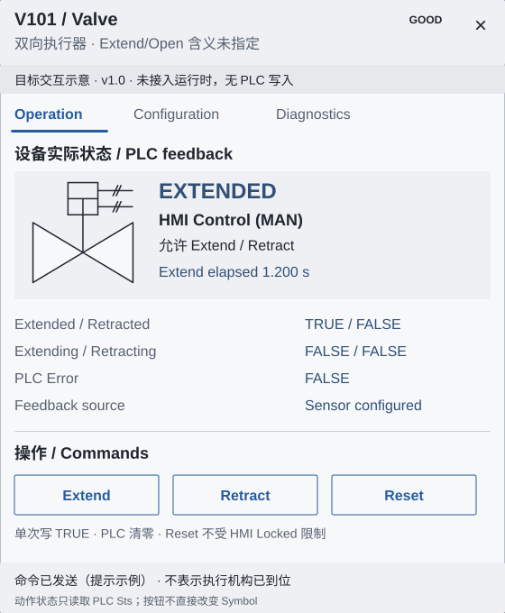
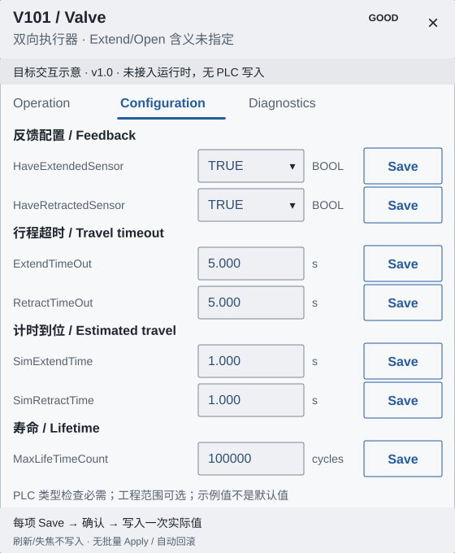

# Faceplate Specification — v1.0

**[冻结规范]** 保留 Operation/Configuration 核心结构和按能力启用的 Diagnostics/Alarms。PLC 负责动作逻辑，HMI 显示反馈、单次发命令、逐项保存配置。参考默认 560×680 CSS px，不是所有设备唯一尺寸。首版不需要报警桥接、批量事务、跨窗口队列或新权限体系。

## 1. 壳层、信息密度与导航

默认宽560、高680；最小宽320，实际宽不超过视口减32，最大高 min(800,viewportHeight-32)。小屏可用8px外边距/全屏单列，保持44px按钮、40px输入与正文可读；不把固定画布整体缩小。Header72px，摘要32px，Tabs44px，Footer56px，正文padding16px，只有正文滚动。组件内容可明确选择适当尺寸；全局Token变更遵守版本流程。

Header 显示 Label、Description、设备类型、质量。Description 可两行；实际宽度不足时省略并可展开，标题保留关键实例标识，不能把整串 PLC 地址塞进标题。正文分“设备实际状态”和“操作”两个明显区域，用组标题、16px间距、分隔线隔开；按钮不是状态灯。中英文按渲染宽度换行，字段标签允许两行，数值+单位一起布局，不能挤到按钮上。

| Tab 顺序 | 条件与行为 |
| --- | --- |
| Operation | 总是，首次打开默认页；已打开窗口聚焦不重置页 |
| Configuration | 有参数；只读权限用户仍可查看 |
| Diagnostics | 有绑定/原始值报告，错误时仍可达 |
| Alarms | 配置完整 adapter 才启用；未配置不制造空报警或阻止核心两页 |
| Trends/Maintenance | 有真实数据源/明确能力再启用，不是首版前置 |

使用文字 Tabs；过窄可横向滚动，活动项始终可达，支持键盘。数据短暂失效不能使 Tabs 突然消失。控制状态和实时显示共用 Contract 的共享 snapshot。

## 2. Operation：反馈与操作分开

上方：设备图、主状态、HMI 控制指示、真实反馈/时间。下方：Extend、Retract、Reset。当前 Valve 不生成 Auto/Manual 切换器、Operator/Program 来源选择器或 Interlock 操作。Extend/Open 物理含义未配置时保持 Extend/Retract。

状态含义、独立维度与动作门控统一遵守[Contract §3](CONTRACT.md#3-valve-有限状态语义)，这里不另定义状态机。显示Fault/Conflict/端位/运动的独立证据；缺H仍显示有效位置、禁Extend/Retract，Reset仅按自己的有效绑定、连接和现有权限判断。无传感器端位标“计时到位”，不能暗示物理传感器已确认。

### 最小命令交互

| 动作 | HMI 写入 | PLC 行为与反馈 |
| --- | --- | --- |
| Extend | Cmd.Extend=TRUE，单次 | PLC 根据 HMIControlAvailable 决定处理，随后清零；继续读 Sts |
| Retract | Cmd.Retract=TRUE，单次 | 同上 |
| Reset | Cmd.Reset=TRUE，单次 | 不受 HMIControlAvailable 限制，处理后清零；继续读 Sts |

本次用户给出的 PLC 逻辑是权威依据，不再要求修改 PLC。HMI 不写 FALSE，不定时脉冲，不自动重试，不要求 PLC ACK/Command ID，不实现设备动作完成状态机或控制仲裁。LifetimeReset 声明存在但处理未证实，首版不启用；这不阻止上述三个核心命令。

UI 只显示：**写入中 → 写入成功（命令已发送）/写入失败**。等待本次请求结果时可临时禁用本控件防止双击，回调后恢复；没有跨窗口锁。ADS 写完成不表示执行机构已到位，也不表示 PLC 一定接受动作。实际位置/运动只读 PLC Sts，按钮绝不能直接改变 Symbol 状态。回调丢失/断线时提示“结果未确认，可能已发送”，不自动补发。

现有项目权限继续适用，状态可见与控制enabled分别判断；不能只靠按钮 disabled。首版不因缺少 IL 诊断字段而造联锁或控制权系统，PLC 最终负责。项目需要某危险动作确认时使用已有确认方式，但普通 Extend/Retract/Reset 不默认新增普遍审批流程。

**[源码确认]** 当前 Prefix/Inherit SVG Widget 没有 postValue，现有发送链也未给出可靠逐次驱动结果。以上是新 native control opt-in 适配的目标，不代表当前可写。准确目标、服务端保存配置解析及写结果补充见 [Contract §6](CONTRACT.md#6-最小-prefixinherit-写入适配方案冻结设计未实现)。

## 3. Configuration：分类、逐项保存

| 分组 | 参数 | 控件 |
| --- | --- | --- |
| Feedback | Cfg.HaveExtendedSensor / HaveRetractedSensor | BOOL 选择/开关，文字明确 TRUE/FALSE；切换仅编辑本项 |
| Travel timeout | Cfg.ExtendTimeOut / RetractTimeOut | 数值输入+单位 s |
| Estimated travel | Cfg.SimExtendTime / SimRetractTime | 数值输入+单位 s，不称为 Simulation enable |
| Lifetime | Cfg.MaxLifeTimeCount | UDINT 输入；提示运行寿命限制行为尚未确认 |

每项有明确 Save，用户修改→Save→确认实例/字段/旧值→新值→写一次实际值。确认可复用已有确认交互，不能在数据刷新、失焦、切页或checkbox change时自动回写。BOOL 也要保存/确认。单行本地编辑值与订阅实际值分开，刷新不能覆盖用户正在编辑的输入；可继续显示旁侧当前PLC值，或提示当前值已变化。没有共享草稿、跨窗口冲突检测/队列；同项不同窗口按 PLC 实际处理顺序生效，之后显示订阅读回。

写入中仅锁本行；写失败保留输入并显示原因，用户自行决定再次保存，绝不自动重试。成功显示“写入成功”，正常订阅值作为实际值，收到不同值仍如实显示；不强制构建读回验证事务，也不把成功文案写成“配置已持久化/动作生效”。PLC 是否持久化取决于 PLC 工程，不由浏览器保证。

| 类型 | 首版必要校验 | 可选工程约束 |
| --- | --- | --- |
| BOOL | 真/假合法值，不进行toggle读改写猜测 | 无 |
| INT/UINT/DINT/UDINT | 整数、位宽/符号：INT -32768..32767，UINT 0..65535，DINT -2147483648..2147483647，UDINT 0..4294967295 | Metadata min/max 若给出必须执行 |
| REAL/LREAL | 有限数字且在实际 PLC 类型可表示范围内；拒绝 NaN/Infinity，不用舍入显示值替代原输入 | Metadata 范围/单位/精度，浮点舍入按类型处理 |
| ENUM/STRING（后续能力） | 必须有真实底层类型+枚举表，或PLC长度/编码信息 | 不编造枚举、不静默截断字符串 |

没有工程范围的 Valve 数值参数至少按 LREAL/UDINT 类型检查，可以保存；**不以缺少min/max/默认值/审批/读回容差为统一禁用理由**。工程范围可选；涉及现场风险的设备约束由项目提供，已有约束不能跳过。defaultValue=null 表示未定义默认，不自动填0或写入。

首版不需要组Apply、批次事务、自动回滚、PLC staging/commit、跨窗口草稿共享。以后有组合配置实际需求再独立设计，不阻塞 Valve。当前静态稿展示目标每项 Save；标明尚未接入运行时，不让示意中的按钮暗示功能已开发。

## 4. 诊断、可选报警与窗口

Diagnostics 提供 deviceId、Prefix、Tag名/类型/解析错误、必要原始状态；缺时间戳显示不可用，不要求新建统一诊断引擎。Alarms 在 adapter配置后展示 active/returned/ack及可选suppression/shelving，不与 PLC Reset 合并；无 adapter只显示 Fault。

现有 Dialog/Card 多实例行为和订阅owner保留。不同实例各自 Context，关闭A不影响B；同设备多个窗口独立观察/编辑，首版不新增设备级锁/仲裁。同一窗口保存请求的回调只更新该窗口本行提示，窗口已关闭就丢弃提示，不撤销/重放PLC写入。保存共享View不包含临时输入、pending/result或已解析运行ID。新实例去重/窗口上限不是首版任务。

## 5. 静态示意

图中数值为演示，TRUE→HMI Control；FALSE 的 HMI Locked 可见于 Symbol 示例。Operation 的“命令已发送”是传输提示示例，不是动作回执。所有控件仅为静态设计，不运行、不写PLC。

背景与恢复：Faceplate始终保持不透明surface背景；透明规则只作用于工艺Symbol。一次性Cmd不启用Restore/离线缓冲/重连补发/自动重试；后端历史Restore行的处理见Contract §10，不以浏览器禁重试代替服务器恢复过滤。
