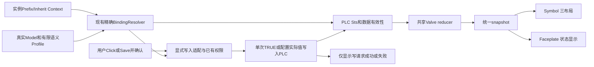
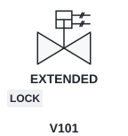
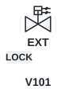
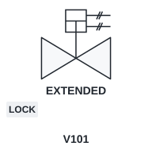
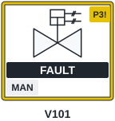
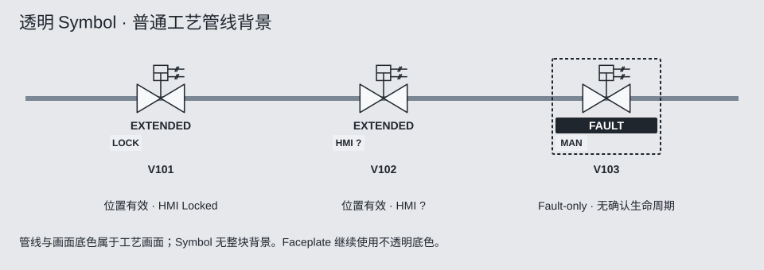
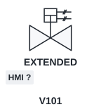
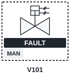

# Symbol Specification — v1.0

**[冻结规范]** 一份声明式模板、一份设备几何、一个有限状态profile，三种纯展示布局。旧 `NexPlc_Valve.svg` 及旧Faceplate保持原状；设计语义保持冻结；当前已交付的只读Valve Symbol及尚未实现能力见[实施边界](README.md#implementation-status)。

## 1. 图形来源与分层

统一使用本地 `D:/Will/Documents/source/repos/FUXA-SVG-Widgets` 的素材，远程 [frangoteam/FUXA-SVG-Widgets](https://github.com/frangoteam/FUXA-SVG-Widgets)。不需要FUXA内置Shape，不再保留原生Shape优先或对比要求。阀类优先检索 `Proc. Engineering/Proc. Eng. Valves`，当前使用25_Gate Valve (Double Acting Cylinder)的既有许可副本；保持几何、比例、双端口和MIT许可，仅适配状态呈现和布局。选择不同设备型式时仍在该库检索，不重新描绘等效符号。详见[来源与许可](assets/PROVENANCE.md)。

从后到前：透明点击热区→局部选择/质量标记→独立报警框→居中设备主体→状态文本→底部统一徽章槽→Label。报警角标独立放右上安全区，不覆盖执行器或管口；编辑焦点和报警框分层。Symbol整块底板透明；Faceplate不透明。无完整alarm adapter时Fault可有独立静态深色虚线强调框，无假报警框。

## 2. 三布局：位置、选择和复用

下表与JSON layouts.variants一致；Box为x,y,width,height，都是冻结的NexFuxa v1.0参数；变更遵守README版本流程。

| 变体 | viewBox | geometryBox | statusBox | iconBox | labelBox / baseline | alarmBox | 槽数 |
| --- | --- | --- | --- | --- | --- | --- | --- |
| compact | 0,0,96,112 | 16,8,64,32 | 8,44,80,18 | 8,64,80,16 | 8,92,80,20 / 108 | 4,4,88,80 | 2 |
| standard | 0,0,144,152 | 24,12,96,60 | 8,78,128,20 | 8,100,128,20 | 8,132,128,20 / 148 | 4,4,136,120 | 3 |
| detailed | 0,0,192,184 | 32,12,128,88 | 8,104,176,20 | 8,128,176,20 | 8,164,176,20 / 180 | 4,4,184,148 | 4 |

geometry等比缩放后按Box水平/垂直居中，原路径/比例/拓扑不变，轮廓建议2px；状态变化不移动管口。geometryBox是允许区域，不要求方形设备非等比填满。只旋转geometry，不旋转文字/徽章；方向0/90/180/270，不推导Open/Close。

Compact的状态使用stateDisplay.shortText，Standard/Detailed用text；同一snapshot，不复制三份语义。Compact徽章16px高、32px槽宽、gap4；Standard/Detailed徽章20px高、40px槽宽、gap4，字12px。槽内短词居中，完整语义通过Faceplate/可访问名称可达。长标签按像素测量省略，完整实例名在Faceplate/Tooltip可达；避免两个实例被截成不可区分。Label建议14px，上限64字符，Description上限256；中英文以实测宽度为准。

选择：Gauge展示覆盖→实例layout.symbolVariant→模板defaultVariant。首版默认standard，已保存布局运行时直接读取，不按Fault或模式自动跳布局；项目后续可显式按缩放级别选变体。变体/位置/间距/文字截断均属Layout，不进入PLC实例键、不改变绑定/状态/命令。

点击热区至少44×44 CSS px，键盘Enter/Space打开Faceplate，不与邻居重叠。尺寸不是所有组件唯一强制值；禁止简单缩小到文字不可读，低密度/高密度选合适变体。DPR/缩放/真实工业屏幕交互仍须验收。

## 3. 共享有限Valve语义

唯一状态规则见[Contract §3](CONTRACT.md#valve-state)，输入映射见[Valve模板](examples/valve.json)。Symbol和Faceplate消费同一个RuntimeSnapshot，不在各自渲染器重新判定状态；三尺寸只选择full/short文案。

位置、运动、Fault及HMI控制分别有效；缺H不抹掉已知位置，未知维度显示问号及原因。断线值不能作实时显示。运动数据无效或Fault/Conflict时停止设备动画，仅H缺失不停止有效运动反馈的显示。按钮不直接把Symbol改成到位。

## 4. 徽章、报警框与Label

底部当前Valve常驻HMI控制徽章；来源/IL/PERM/BYP/OVR/SIM只有真实能力时才显示。正常未配置不占槽；配置但未知用?。优先级：质量异常→BYP→SIM→IL→PERM→OVR→HMI控制/真实模式→真实来源。超槽保留capacity-1项，最后+N可展开完整清单；故障主文本/报警角标在槽外，永不被溢出隐藏。

完整报警按STYLE规则：有活动/恢复待确认时出现，最高可显示活动严重性优先，确认不等于PLC Reset。P3 3px黄线必须叠在5px深色底线，角标深字P3!；消除浅底低对比问题。实际可见边缘（含底描边）与Label文字框至少4px，框不穿字；上述Box刻意留出独立标签带。报警角标建议同尺寸外侧右上角安全位，并用实测边界检查不遮geometry。

未接报警服务的首版Valve显示Fault及可选的默认静态深色虚线强调框，完整P2/P3报警图是未来扩展目标；服务数据坏时保留最后已知摘要且标STALE，不把通信断开当RTN。Suppressed/Shelved保留独立状态与明细，不能抹掉事件原始active/ack。

## 5. 其他设备与扩展

| 类型 | 保留的真实语义/几何 | 禁止推导 |
| --- | --- | --- |
| Cylinder | 缸体/杆/安装方向、端位与运动 | 用阀图代替所有气缸、假连续位移 |
| Motor | Motor轮廓，运行/启动/停机反馈 | Cmd.Start=Running |
| Pump | 正确泵型/管口，运行与流量分开 | Motor Running=建立流量/压力 |
| Analog | PV/单位/量程、数据质量 | 越限=完整已确认报警；无动作却生成Start |

统一从FUXA-SVG-Widgets检索并审查许可；第二种设备真实模型确认后增加有限profile，不复制Valve渲染器或提前建通用引擎。三布局壳层和报警/Label语言可复用。

## 共享状态管线

写结果不直接修改U；只有PLC反馈更新状态。未来报警adapter可向snapshot补充可选alarmSummary，不阻塞此管线。

## 6. 静态设计稿

三尺寸示例使用相同Extended+HMI Locked输入，仅布局不同。当前Valve没有IL绑定。许可/几何来源见 [PROVENANCE](assets/PROVENANCE.md)。

## 7. SVG内部ID与实例隔离

**[源码确认]** SvgUtils.renameIdsInSvg为所有节点ID加当前svgGuid后缀，并改属性url(#id)/href/xlink:href；HtmlImageComponent在导入、已保存/复制Widget运行实例化时重建svgGuid、script module和ID映射。ViewRuntimeContext另外为同View不同窗口分配viewInstanceId，改写View DOM引用、CSS ID、ARIA/事件引用并清理资源。沿用这两层机制，不手工拼V101/V102后缀，不另建全局ID服务。

必须遵守：

1. 单个源SVG内部ID唯一且稳定，例如valveSymbol/valveBody；每个运行副本的所有ID（含defs/clip/mask/title/desc）必须经既有映射，跨模板/跨窗口也不能重复。同设备开两窗仍是两个DOM实例，PLC实例键不代替DOM实例键。
2. 运行代码优先从本实例根节点查找data-part/data-role；既有脚本若用document.getElementById，只允许可被现有编译器替换的完整静态ID字符串。禁止动态拼接ID、document全局class/tag查询、跨实例querySelector，禁止共享window.currentValve或模板单例保存状态。
3. 图形优先用presentation属性/局部样式；禁止未限定作用域的SVG style选择器和全局CSS @keyframes名称。动画只操作本实例节点/闭包；timer、事件、rAF及SVG.js动画引用归本模块，destroy取消，关闭A不能停止B。
4. 当前Widget层仅改写属性中的url(#id)与href；不能假设它支持ARIA ID列表、style文本中的#id、SMIL begin/end事件ID、JS选择器片段或任意CSS动画名称。View层支持更多引用也不能替代Widget导入时核对。首版Widget根可用aria-label避免ARIA IDREF；需保留aria-labelledby/描述引用时，adapter使用同一现有ID map补全引用并验收，不增第二套命名算法。首版不使用SMIL事件ID/全局keyframes。
5. ID映射只改运行副本，保存模板与许可不被覆盖；重复初始化按existing previousId去旧后缀，不使ID无限增长。defs的url引用和use必须仍指向同实例。写请求使用保存definition IDs，不能拿运行DOM ID当Tag ID。

现有静态设计SVG以独立img/document展示，title/desc ID局部有效；若做内联组合示意，先用既有renameIdsInSvg映射并处理必要ARIA引用，不能原样拼接多份。验收覆盖同模板三实例、同PLC实例双窗、两个Faceplate、defs/use/可访问名称、动画开关及关闭A后B更新。

## 8. 透明与工艺背景示意

工艺背景/管线只存在于组合画面，不属于Symbol资产；单个Symbol不含整块背景rect。局部状态填色与徽章保留。Fault-only框不占用报警生命周期，规则见Contract §10。
